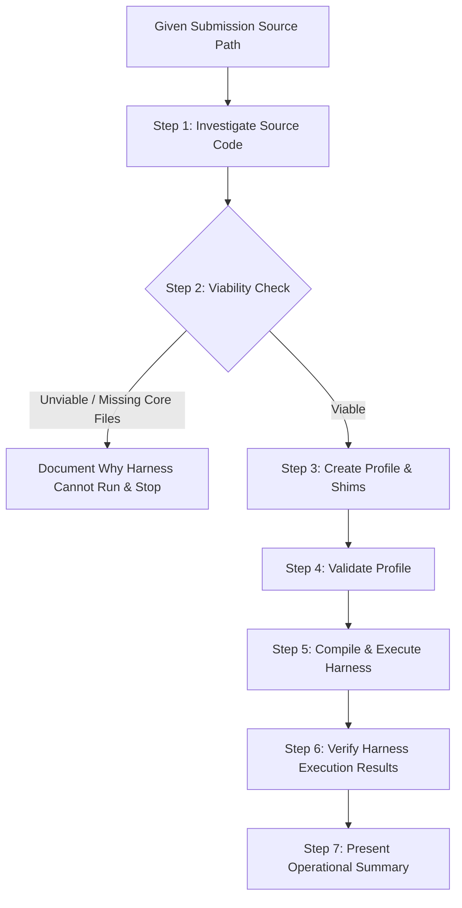

# Prepare MemTacToe Implementation for Review

Use this skill when given source code for a MemTacToe implementation (CWU CS470 Lab 2) to prepare, configure, compile, and evaluate it with the `mem-tac-review` test harness.

> [!IMPORTANT]
> **Strict Operational Boundaries:**
> 1. **Do not modify or fix student code:** If an implementation fails to compile, crashes, deadlocks, or cannot be run by the harness, document the issue and state why. Never patch or alter student source files to make them compile or pass.
> 2. **Do not evaluate or grade game logic correctness:** The test harness is **not** an auto-grader. It produces review evidence (side-by-side terminal transcripts and reference states) for a human evaluator. Verify only that the harness ran correctly (operational delivery); do not judge board correctness or assign scores.
> 3. **Use the Shim Pattern for interface adaptations:** For non-standard inputs (such as reading grid size via interactive stdin), use external wrapper scripts (shims) without modifying student code.

---

## Workflow Steps



---

### Step 1: Investigate the Implementation Source Code

Examine the student submission directory to determine its architecture and interface conventions.

1. **Run the inspection helper:**
   ```bash
   python3 .agents/skills/prepare-mem-tac-toe/scripts/inspect_submission.py <path_to_submission>
   ```
2. **Review key code attributes:** Refer to the [Source Investigation Checklist](./references/source-investigation-checklist.md):
   - **Entry Points & Topology:** Does it have two executables/mains (`topology: "dual"`), or a single process with `fork()` (`topology: "single"`), or a single binary run twice with different arguments?
   - **Launch Arguments:** Does Player 1 take `{N}` on the command line? Does Player 2 require `{N}` or role flags? Does it expect an extra shared-memory name or game key?
   - **Coordinate Conventions:**
     - Base: `coord_base: 0` (0 to N-1) vs `coord_base: 1` (1 to N). Look for `row--`, `r-1`, or prompts like `(1-N)`.
     - Order: `coord_order: "row_col"` (row first) vs `coord_order: "col_row"` (Cartesian x then y).
     - Format: `input_format: "{r} {c}\n"` (space-separated), `"{r},{c}\n"`, or multiple prompts `["{r}\n", "{c}\n"]`.
   - **Turn Prompt & Pacing:**
     - Identify the prompt string (e.g. `printf("Player %c enter move: ")`). Set `turn_prompt: "<regex>"`.
     - Set `settling_ms: 100` (or `120`-`150` if prompts lack newlines/colons).
   - **Compilation Requirements:** Note necessary compiler flags (`-Wall -Wextra -O2`, `-pthread`, `-lrt`, `-lm`, or `-std=c2x` if `bool` is used without headers).

---

### Step 2: Viability Assessment

Determine whether the submission can be executed with `mem-tac-review`:
- **Unviable conditions:**
  - Code requires a graphical desktop environment (X11, SDL, GUI).
  - Crucial source files are completely missing.
  - Code fundamentally fails compilation under standard Linux compilers and cannot be built.
- **Action if unviable:** Stop immediately, output an explanation detailing why the harness cannot be run on this implementation, and do not attempt to patch the code.

---

### Step 3: Create Configuration Files (Profile & Shims)

1. **Write the Profile:** Create `profiles/<submission_name>.yaml` adhering to the [Profile Schema Reference](./references/profile-schema.md).
   - Ensure `work_dir` points to the directory containing the source/binaries (relative to the profile file or absolute).
   - Example starter template:
     ```yaml
     name: "<submission_name>"
     build_cmd: "gcc -Wall -Wextra -O2 -o player1 player1.c && gcc -Wall -Wextra -O2 -o player2 player2.c"
     work_dir: "../submissions/<submission_name>/src"
     topology: "dual"
     launch_p1: ["./player1", "{N}"]
     launch_p2: ["./player2", "{N}"]
     creator: "p1"
     starting_player: "p1"
     p1_mark: "X"
     p2_mark: "O"
     coord_base: 1
     coord_order: "row_col"
     input_format: "{r} {c}\n"
     turn_prompt: "enter row and column"
     settling_ms: 100
     timeout_sec: 5.0
     ```
2. **Create Shims (If Needed):** If the program expects input via stdin rather than CLI arguments (or requires argument adapters), create a wrapper script following [Shim Patterns](./references/shim-patterns.md). Place the shim in the submission directory or wrapper directory and ensure `chmod +x` is set.

---

### Step 4: Validate Profile

Verify syntax and required fields with the built-in validator:
```bash
uv run mem-tac-review validate-profile profiles/<submission_name>.yaml
```
If validation reports errors (e.g. invalid topology, missing name, bad coord_base), correct the profile configuration.

---

### Step 5: Compile & Execute the Test Harness

1. **Smoke Test (Single Scenario):**
   Run scenario `G01` first to verify basic process launch and PTY communication:
   ```bash
   uv run mem-tac-review run --profile profiles/<submission_name>.yaml --scenario G01 -v
   ```
2. **Canonical Suite Execution:**
   Execute the full canonical `lab-2` test suite:
   ```bash
   uv run mem-tac-review run --profile profiles/<submission_name>.yaml \
     --suite lab-2 \
     --output reports/<submission_name> -v
   ```

---

### Step 6: Verify Harness Execution Results

Consult the [Harness Verification Guide](./references/harness-verification-guide.md) to inspect the generated evidence:
1. Confirm generation of `reports/<submission_name>/report.html` and `report.json`.
2. Inspect `build_result` in `report.json`:
   - If compilation failed, check compiler error text.
3. Inspect `scenario_results`:
   - Verify how many scenarios completed interaction (`completed`).
   - Check if any scenarios timed out (`timed_out`), failed to launch (`launch_error`), or crashed (`interrupted`).
4. Check `ipc_leaks_detected`:
   - Note any lingering System V shared memory segments left behind by the implementation.

---

### Step 7: Output Results Summary

Present the operational outcome to the user:
- State whether the test harness ran successfully.
- Link to the generated `report.html` and `report.json`.
- Summarize build status, scenario completion count, and any observed execution issues (crashes, timeouts, IPC leaks).
- Clearly state that evaluation of game correctness and grading criteria remains with the human reviewer.
